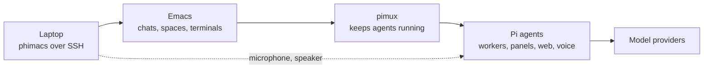

# Phimacs

Run [Pi](https://github.com/earendil-works/pi-mono) coding agents inside Emacs.
Your agents keep running when you close Emacs, and you can connect to them
again from another computer.

[](docs/demo/README.md)

## What you get

- **Chats and project spaces in Emacs.** Each project has its own space with its
  own window layout. A sidebar lists all agents and shows which ones need you.
- **Agents that keep running.** A background service, pimux, runs the agents.
  Closing Emacs or losing an SSH connection does not stop them. Only the Close
  command stops an agent. When the service starts again, for example after a
  reboot, your agents come back idle with their conversations. Unfinished work
  and workers do not come back.
- **Workers.** An agent can give a task to a helper agent, a "worker", also on
  another model, and get the result back.
- **Terminal panels.** Agents can run servers and other long commands in
  terminals that you can see and use too.
- **Other computers.** Run `phimacs` on a laptop to open the same agents over
  SSH. The laptop can also lend its microphone and speaker to the agents.
- **Optional tools** for web browsing and search, dictation and speech.

> **Why this exists:** Phimacs brings together tools that I wrote over the past
> year for my own work with Pi agents. For a long time I used
> [Herdr](https://herdr.dev), a terminal workspace for coding agents. When Emacs
> turned 50, I went back to Emacs and rebuilt, as Emacs packages, the Herdr
> features that I use. I
> [mentioned this on Hacker News](https://news.ycombinator.com/item?id=50298436#50300314),
> and people asked me to publish it. So I put my setup into this one repository,
> to make it easy to try.

## Status

Early: version 0.1.0. I use it every day, but expect rough edges. It runs on
Linux only and is tested with Pi 1.5.2. Use the `main` branch.

## Get started

**With a coding agent:** point it at the [installation guide](docs/install.md).

**Without Emacs:** the agent tools also work in plain `pi` in Herdr or tmux; see
[Pi in Herdr or tmux](docs/install.md#pi-in-herdr-or-tmux-without-emacs).

### Complete Emacs setup

You need Linux, Git, a C compiler, Node 24 or newer, and Emacs 31.1 or newer
built with tree-sitter and module support.

```sh
npm install --global --ignore-scripts @earendil-works/pi-coding-agent@1.5.2  # if you do not have Pi
git clone https://github.com/offline-ant/phimacs
cd phimacs
npm ci --ignore-scripts
npm run compile
ln -s "$PWD/bin/phimacs" ~/.local/bin/phimacs
pi                # log in with /login, choose a model with /model, then exit
phimacs setup     # once: installs Emacs packages and compiled helpers
phimacs           # opens Emacs in this terminal; add --gui for a window
```

Phimacs uses its own Emacs daemon and does not change `~/.emacs.d`. The
[installation guide](docs/install.md) explains each step and how to connect
from other computers.

### Your own Emacs configuration

Install only the packages that you want with `use-package :vc`. You do not need
the theme, completion or keys of the complete setup. See
[existing Emacs configuration](docs/install.md#existing-emacs-configuration).

## How the parts fit together



Emacs runs on one computer, the host. pimux runs the agents there, and Emacs
only shows them. Other computers open Emacs on the host over SSH and can lend
it their microphone and speaker.

## License

Phimacs's own code is MIT. The Pilish chat package in `emacs/pilish/` is a fork
of [Pilish](https://github.com/dnouri/pilish) and stays GPL-3.0-or-later.
Third-party files keep their own licenses; see
[third-party sources](provenance/README.md). Phimacs does not include my private
model providers, accounts, credentials or personal settings.

## Documentation

Using Phimacs:

- [Installation](docs/install.md)
- [Demo](docs/demo/README.md)

Contributing:

- [Development and focused checks](docs/development.md)
- [Architecture](docs/architecture.md)
- [Runtime lifecycle](docs/lifecycle.md)
- [Runtime protocol](docs/runtime-contract.md)
- [Pilish upstream maintenance](docs/pilish-upstream.md)
- [Dependency security](docs/dependency-security.md)
