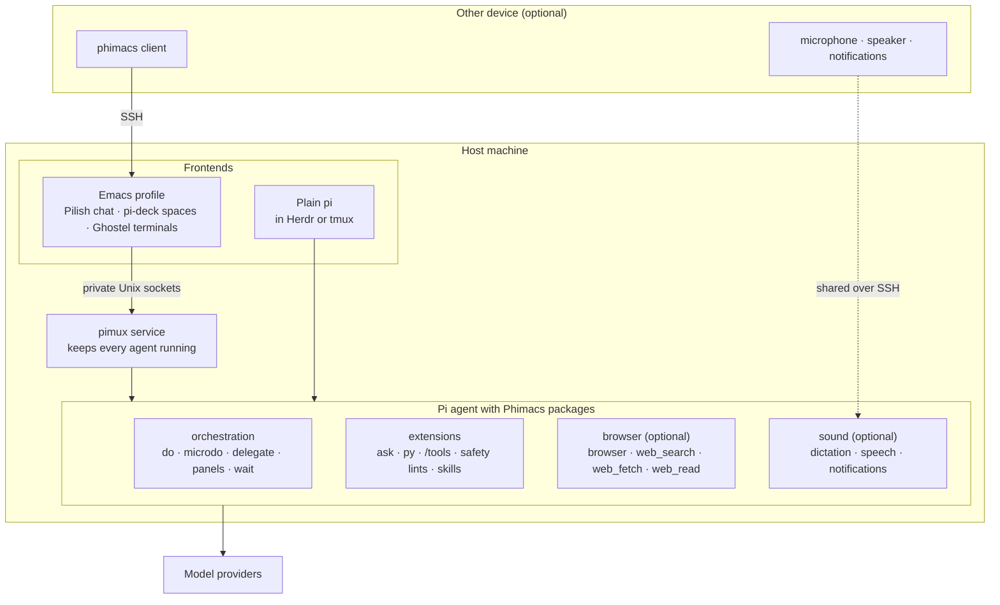

# Phimacs


> **Why this exists:** Phimacs brings together tools that I wrote over the past
> year for my own work with Pi agents. For a long time I used
> [Herdr](https://herdr.dev). When Emacs turned 50, I went back to Emacs and
> rebuilt the Herdr features that I use as Emacs packages. I
> [mentioned this on Hacker News](https://news.ycombinator.com/item?id=50298436#50300314),
> and people asked me to publish it. So I put my setup into this one repository,
> to make it easy to try.

Phimacs runs [Pi](https://github.com/earendil-works/pi-mono) coding agents in
Emacs. You chat with agents in Pilish and keep each project in its own pi-deck
space. A background service, pimux, keeps every agent running, also when Emacs
is closed.

## How the parts fit together



- **pimux** starts and keeps the Pi agents and their workers. Emacs only shows
  them. When Emacs closes, the agents continue. Only an explicit Close stops an
  agent.
- **Frontends:** the Emacs profile shows chats, project spaces, a sidebar and
  terminals. You can also use plain `pi` in Herdr or tmux, without Emacs.
- **Packages** add tools to each agent. The Emacs profile turns on
  orchestration (workers and terminal panels) by default. The general
  extensions, browser tools and sound are separate choices.
- **Other devices** run a small `phimacs` client over SSH. They can also lend
  their microphone, speaker and notifications to the host.

The [architecture](docs/architecture.md) page has more detail.

## Three ways to use it

- **Keep your Emacs configuration.** Install only the packages that you want
  with `use-package :vc`. You do not need the profile's theme, completion or
  keys.
- **Try the complete profile.** Run `phimacs`. It starts the pimux service and
  its own Emacs daemon, or connects to them, and opens a terminal frame. Use
  `--gui` for a graphical frame. The profile does not change `~/.emacs.d`.
- **Use plain `pi` in Herdr or tmux, without Emacs.** You get workers, panels
  and the general extensions. You need Node 24 or newer and Pi on your PATH:

  ```sh
  git clone https://github.com/offline-ant/phimacs
  phimacs/bin/phimacs setup pi
  pi
  ```

  Read [Pi in Herdr or tmux](docs/install.md#pi-in-herdr-or-tmux-without-emacs)
  for options, updates and how to move from `pi-ant` or `pi-browser`.

For the complete profile, follow the [installation guide](docs/install.md):

1. Clone and compile.
2. Log in to a model provider.
3. Run `phimacs setup` once. It installs the pinned packages and native parts.
4. Run `phimacs`. Normal startup installs nothing.

The [runtime lifecycle](docs/lifecycle.md) explains what happens when you close
Emacs, lose a connection or close an agent.

## Requirements

The complete profile needs:

- Linux
- Node 24 or newer
- Emacs 31.1 or newer, with tree-sitter and native modules
- Pi 1.5.2 (the tested version)

Plain `pi` in Herdr or tmux needs only Linux, Git, Node and Pi. Checks pass on
Emacs 31.1 and 32.0.50. The
[development guide](docs/development.md#emacs-build-selection-and-qualification)
lists the test lanes.

## What is in this repository

This one repository has the maintained Pilish fork, the reusable packages and
the optional profile. Pilish stays GPL-3.0-or-later. Other code and assets keep
their own licenses. Private providers, account and device settings, credentials
and personal settings are not part of Phimacs.

## Documentation

- [Installation](docs/install.md)
- [Architecture](docs/architecture.md)
- [Runtime lifecycle](docs/lifecycle.md)
- [Runtime protocol](docs/runtime-contract.md)
- [Development and focused checks](docs/development.md)
- [Pilish upstream maintenance](docs/pilish-upstream.md)
- [Dependency security](docs/dependency-security.md)
- [Third-party sources and licensing](provenance/README.md)
